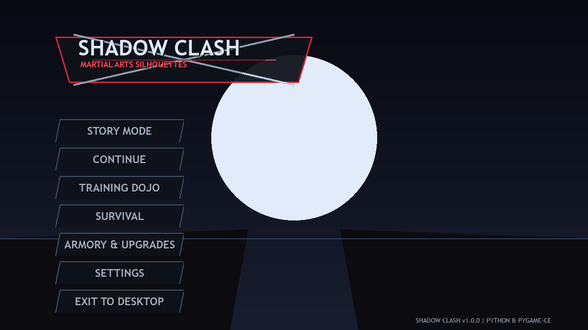
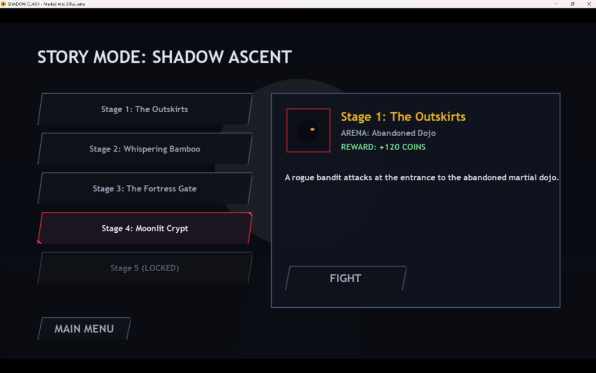
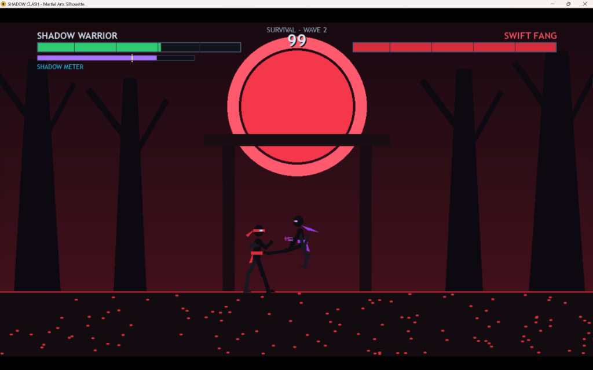

# Shadow Clash

[](https://www.python.org/downloads/)
[](LICENSE)
[](https://pyga.me/ce/)

> An atmospheric 2D martial arts silhouette fighting game built with Python, pygame-ce, Pillow, and NumPy.

---

## Overview

**Shadow Clash** is a complete, standalone 2D fighting game featuring responsive combat, frame-data-driven mechanics, adaptive enemy AI, weapon progression, and multiple game modes. Inspired by classic martial arts fighting titles, the game delivers technical depth through precise hitbox detection, guard breaking, combo systems, and the strategic Shadow Burst special meter.

Players control the **Shadow Warrior**, battling through an ancient shadow order across atmospheric arenas illuminated by celestial moons and elemental accents. Combat emphasizes timing, distancing, and resource management.

---

## Screenshots







---

## Quick Start

### Prerequisites

- Python 3.10 or higher
- Windows 10/11, Linux, or macOS
- 1 GB RAM, 150 MB storage

### Installation

```bash
# Clone or navigate to the project directory
cd Shadow_Clash

# Create and activate virtual environment (recommended)
python -m venv venv
.\venv\Scripts\Activate.ps1  # Windows
# source venv/bin/activate  # Linux/macOS

# Install dependencies
pip install -r requirements.txt
```

### Running the Game

```bash
# Normal gameplay
python main.py

# Headless smoke test (CI/CD environments)
python main.py --smoke-test
```

---

## Features

### Core Gameplay

- **Silhouette Visual Style**: Dark martial silhouettes with glowing accents and crisp hitboxes
- **60 FPS Combat Engine**: Full frame-data mechanics (active/startup/recovery windows), single-hit guarantees, block mitigation, and guard-break systems
- **Adaptive AI ("Shadow Resonance")**: Enemy AI analyzes player tendencies and dynamically adjusts tactical decisions
- **Shadow Burst Special**: Powerful special attack requiring 60% energy meter, dealing heavy damage with launch knockback

### Game Modes

| Mode | Description |
|------|-------------|
| **Story Mode** | 5-stage progressive campaign with multi-phase boss encounter against the Shadow Master |
| **Training Dojo** | Practice dummy with behavior toggles (Stand/Guard/Attack), real-time damage feedback |
| **Survival Gauntlet** | Endless waves with increasing difficulty, 35% health restoration between rounds |
| **Armory (Shop)** | Purchase weapons and upgrade martial stats with persistent economy |

### Arenas

- **Abandoned Dojo**: Weathered shoji frames, hanging lanterns, polished tatami floors
- **Crimson Forest**: Blood-moon twilight, gnarled silhouettes, drifting leaves
- **Ruined Temple**: Fractured pagodas, crumbling pillars, glowing violet runic flagstones

### Progression System

- **Weapons**: Training Gloves, Steel Knuckles, Shadow Blade, Eclipse Staff
- **Upgrades**: Strength, Vitality, Defense, Special Surge
- **Persistent Economy**: Coins earned through combat, spent on armory purchases
- **Achievements**: Milestone unlocks with reward distribution

### Technical Features

- **Procedural Audio**: 17 original 44.1kHz stereo sound effects and music tracks synthesized without external dependencies
- **Atomic Save System**: Schema-versioned JSON persistence with automatic `.bak` recovery and corruption protection
- **Asset Generation**: All 120 sprite sheets, arenas, effects, and audio can be regenerated via included tools

---

## Controls

| Action | Primary Key | Secondary Key |
|--------|-------------|---------------|
| Move Left | `A` | Left Arrow |
| Move Right | `D` | Right Arrow |
| Jump | `W` | Up Arrow |
| Crouch | `S` | Down Arrow |
| Light Punch | `J` | - |
| Heavy Punch | `U` | - |
| Light Kick | `K` | - |
| Heavy Kick | `I` | - |
| Low Sweep | `S` + `J`/`K` | - |
| Jump Punch | `J`/`U` (in air) | - |
| Jump Kick | `K`/`I` (in air) | - |
| Block | `L` | Spacebar |
| Shadow Burst | `O` | `Q` |
| Pause/Resume | `Escape` | `P` |

---

## Combat Mechanics

### Hitbox System
Physical bounding volumes calculated from character positions, limb extensions, and facing direction. No distance-only approximations.

### Single-Hit Guarantee
Each attack maintains a `targets_hit` set, preventing the same opponent from being hit multiple times across consecutive frames.

### Directional Blocking
- Reduces incoming damage by 75% and knockback by 65%
- Requires defender to be grounded and facing the attacker
- Turning your back bypasses the guard

### Guard Break
Consecutive heavy strikes against a blocking opponent accumulate guard stress. Exceeding the threshold triggers a prolonged stun.

### Combo System
Chains consecutive strikes landed within 1.7 seconds. Escalating combos award bonus energy for the special meter.

---

## Enemy AI Archetypes

| Archetype | Playstyle |
|-----------|-----------|
| **Rogue** | Balanced beginner, light combos, modest block rate |
| **Swift Fang** | High agility, fast kicks, frequent tactical evasions |
| **Iron Guard** | Heavy block tendency, high defense, deliberate counter-attacks |
| **Night Reaper** | Aggressive weapon combos, punishes recovery gaps |
| **Shadow Master (Boss)** | 3 health-gated phases with increasing speed and damage |

### Shadow Resonance (Adaptive AI)
The AI analyzes recent player action history:
- **Aggressive players**: AI increases block anticipation and counter-attacks during recovery
- **Defensive players (turtling)**: AI triggers low sweeps and guard-breaking strikes

---

## Project Structure

```
shadow-clash/
├── main.py                 # Game executable and CLI entrypoint
├── settings.py             # Canvas dimensions, physics constants, key bindings
├── requirements.txt        # Python dependencies
├── README.md               # This file
├── LICENSE                 # MIT License
│
├── game/                   # Core game systems
│   ├── application.py      # Application lifecycle, main loop, 60 FPS clock
│   ├── scene_manager.py    # Canvas aspect-scaling with letterboxing
│   ├── input_manager.py    # Key mapping, coordinate transformations
│   ├── asset_manager.py    # Image, font, and sprite sheet caching
│   └── audio_manager.py    # 16-channel mixer, volume control
│
├── entities/               # Game entities
│   ├── fighter.py          # Base fighter physics, health, animation
│   ├── player.py           # Player-controlled fighter
│   ├── enemy.py            # Enemy fighter with boss phases
│   └── weapon.py           # Weapon data, reach bonuses, damage multipliers
│
├── combat/                 # Combat systems
│   ├── attack.py           # AttackData specifications (JSON-loaded)
│   ├── hitbox.py           # Bounding hitboxes and hurtboxes
│   ├── collision.py        # Geometric intersection resolution
│   ├── combo_system.py     # Combo tracking, damage counter, timeout
│   └── combat_system.py    # Collision evaluation, damage mitigation
│
├── ai/                     # Artificial intelligence
│   ├── enemy_controller.py # State-driven tactical decision loop
│   ├── adaptive_behavior.py# Shadow Resonance player analysis
│   └── behavior_tree.py    # Selector, Sequence, Condition, Action nodes
│
├── systems/                # Game systems
│   ├── progression.py      # Stage unlocks, upgrade calculations
│   ├── save_manager.py     # Atomic JSON persistence, backup recovery
│   ├── economy.py          # Weapon purchases, coin transactions
│   ├── achievements.py     # Milestone achievements, unlock rewards
│   └── particles.py        # Hit sparks, block barriers, floating text
│
├── scenes/                 # Game scenes
│   ├── base_scene.py       # Abstract BaseScene lifecycle
│   ├── main_menu.py        # Main navigation hub
│   ├── mode_select.py      # Story mode stage selection
│   ├── combat_scene.py     # 1-on-1 battle arena, pause menu
│   ├── training_scene.py   # Dojo training sandbox
│   ├── survival_scene.py   # Consecutive wave gauntlet
│   ├── shop_scene.py       # Armory store for weapons/upgrades
│   ├── settings_scene.py   # Audio volume sliders, controls
│   └── results_scene.py    # Match conclusion, rewards, stats
│
├── ui/                     # User interface
│   ├── components.py       # CombatHUD (health, energy, timer, combo)
│   ├── health_bar.py       # Trailing delayed damage bar
│   ├── energy_bar.py       # Special meter with thresholds
│   ├── buttons.py          # Interactive buttons with audio cues
│   ├── notifications.py    # Sliding toast notifications
│   └── typography.py       # High-contrast text rendering
│
├── data/                   # Game data (JSON)
│   ├── attacks.json        # Frame timings, hitboxes, knockback, energy
│   ├── enemies.json        # Archetypes and boss configurations
│   ├── weapons.json        # Weapon stats and pricing
│   ├── upgrades.json       # Stat progression tiers and costs
│   ├── stages.json         # Story stage definitions
│   └── achievements.json    # Milestone definitions and rewards
│
├── assets/                 # Game assets
│   ├── characters/         # 120 sprite sheets (6 archetypes × 20 states)
│   ├── arenas/             # 1280x720 layered backgrounds
│   ├── effects/            # Impact sparks, block barriers, nova
│   ├── ui/                 # Logo, menus, portraits, buttons
│   ├── icons/              # Currency and weapon icons
│   ├── audio/              # 17 synthesized WAV SFX and BGM tracks
│   └── assets_manifest.json # Master asset manifest
│
├── tools/                  # Asset generation and validation
│   ├── generate_assets.py  # Procedural visual asset generator
│   ├── generate_audio.py   # Procedural audio synthesizer
│   ├── validate_assets.py  # Integrity verification suite
│   └── capture_screenshots.py # Automated QA screenshot tool
│
├── tests/                  # Test suite
│   ├── test_fighter.py     # Fighter physics, gravity, boundaries
│   ├── test_combat.py      # Hitbox windows, blocking, combos
│   ├── test_enemy_ai.py    # AI approach, attack selection, boss phases
│   ├── test_progression.py # Upgrades, economy, stage unlocking
│   ├── test_save_manager.py# Persistence, atomic writes, backup recovery
│   └── test_game_states.py # Scene transitions, pause/resume lifecycle
│
└── saves/                  # Local save directory
```

---

## Asset Management

All game assets can be regenerated or validated using the included tools:

```bash
# Generate visual assets (sprite sheets, arenas, effects, icons)
python tools/generate_assets.py

# Generate audio assets (SFX and BGM tracks)
python tools/generate_audio.py

# Validate asset integrity
python tools/validate_assets.py

# Capture QA screenshots
python tools/capture_screenshots.py
```

---

## Testing

Run the complete test suite:

```bash
# Run all tests with pytest
python -m pytest -v tests

# Run individual test modules
python -m unittest tests/test_fighter.py
python -m unittest tests/test_combat.py
python -m unittest tests/test_enemy_ai.py
python -m unittest tests/test_progression.py
python -m unittest tests/test_save_manager.py
python -m unittest tests/test_game_states.py
```

---

## Save System

Saves are persisted in `saves/shadow_clash_save.json` with robust data integrity:

- **Atomic Writing**: Files are written to a temporary `.tmp` file with `os.fsync()` before atomic rename
- **Automatic Backups**: `.bak` copies created on each successful write
- **Corruption Recovery**: Loader merges valid values over schema defaults without resetting progression
- **Trigger Points**: Saves occur after combat victories, weapon purchases, and upgrade investments

---

## Troubleshooting

### No available video device (Headless CI)
**Problem**: `pygame.error: No available video device`

**Solution**: Run with `--headless` or `--smoke-test`, or set:
```python
os.environ["SDL_VIDEODRIVER"] = "dummy"
```

### Pip connection timeout
**Problem**: Timeout when downloading `pygame-ce`

**Solution**: Use the verified PyPI mirror:
```bash
pip install -i https://mirrors.aliyun.com/pypi/simple/ pygame-ce
```

### Audio stuttering
**Problem**: Audio crackling on low-end hardware

**Solution**: Lower volume sliders in the Settings menu. The `AudioManager` buffer size is set to 1024 samples.

---

## Technology Stack

| Component | Technology | Version |
|-----------|-----------|---------|
| Language | Python | 3.10+ |
| Framework | pygame-ce | 2.5.8+ |
| Image Processing | Pillow (PIL) | 12.0+ |
| Audio Synthesis | NumPy | 2.0+ |
| Testing | pytest / unittest | Latest |

---

## Limitations & Future Work

### Current Limitations
- Local single-player vs AI only (no online rollback netcode)
- Fixed 2-fighter bouts (no 2v2 tag team mode)

### Planned Features
- Local 2-Player Versus Mode with gamepad support
- Additional secret boss encounters and unlockable fighter skins
- Gamepad vibration / haptic feedback via SDL2 GameController API

---

## License

This project is licensed under the **MIT License**. See [LICENSE](LICENSE) for details.

---

## Contributing

Contributions are welcome! Please ensure:
- Code follows existing style conventions
- All tests pass before submitting
- New features include appropriate tests
- Documentation is updated for any API changes

---

## Support

For issues, bug reports, or questions:
- Check the [Troubleshooting](#troubleshooting) section
- Review existing GitHub issues
- Create a new issue with detailed reproduction steps

---

**Shadow Clash** — Built with passion for fighting game precision and atmospheric martial arts aesthetics.
